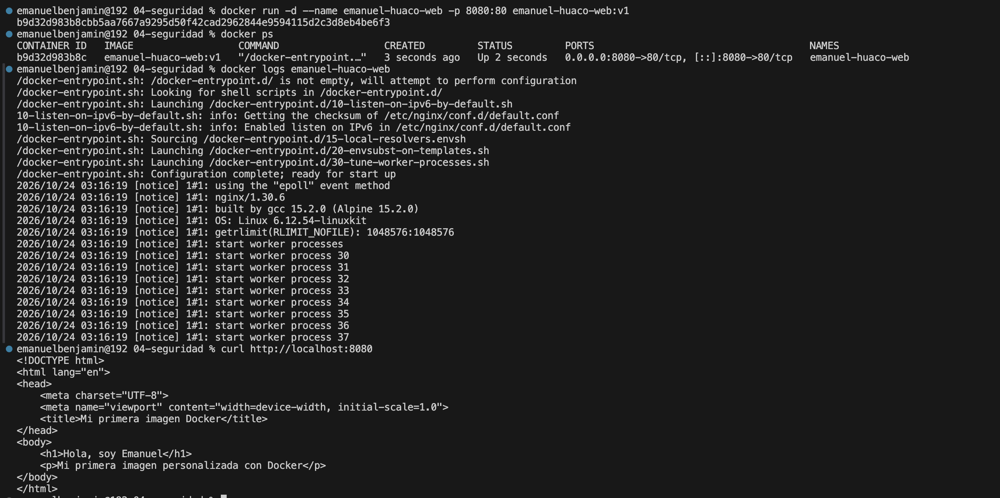

# Laboratorio 01 - Primera imagen Docker con Nginx

## Datos
**Nombre:** Emanuel Huaco  
**Imagen:** `emanuel-huaco-web:v1`  
**Puerto:** `8080`

## Objetivo
Construir una imagen Docker personalizada a partir de Nginx y publicar una página web estática que muestre el nombre completo del alumno.

## Procedimiento

### 1. Construcción de la imagen
```bash
docker build -t emanuel-huaco-web:v1 .
```

### 2. Ejecución del contenedor
```bash
docker run -d --name emanuel-huaco-web \ -p 8080:80 emanuel-huaco-web:v1
```
## Evidencias


### Resultado
Se verificó que la imagen se construyó con éxito a partir de Nginx y que el contenedor responde correctamente en el puerto 8080

### Conclusiones
Se aprendió a empaquetar y desplegar contenido estático utilizando un Dockerfile básico con las instrucciones FROM y COPY, además de gestionar puertos locales mediante contenedores