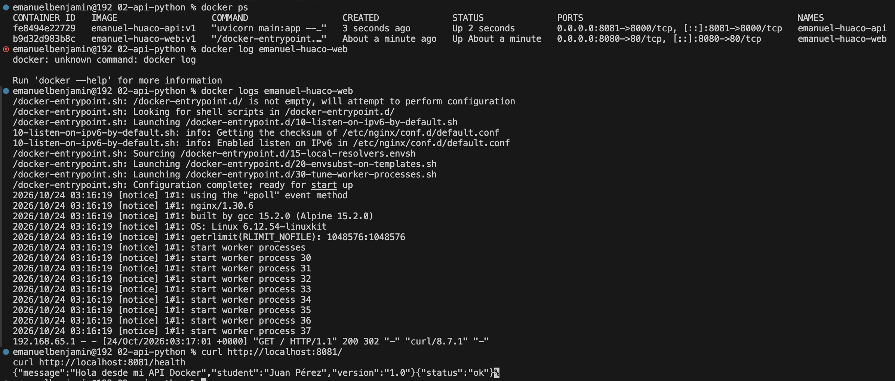

# Laboratorio 02 - API Python con FastAPI

## Datos
**Nombre:** Emanuel Huaco  
**Imagen:** `emanuel-huaco-api:v1`  
**Puerto:** `8081` (8000 interno)

## Objetivo
Dockerizar una aplicación construida en Python utilizando FastAPI y gestionar la instalación de dependencias mediante `requirements.txt`.

## Procedimiento

### 1. Construcción de la imagen
```bash
docker build -t emanuel-huaco-api:v1 .
```

## Evidencias


### Resultado
Se verificó la correcta construcción de la imagen de Python con FastAPI y el funcionamiento del contenedor respondiendo exitosamente en el puerto 8081 con los endpoints configurados.

### Conclusiones
Se aprendió a empaquetar aplicaciones backend en Python, configurar entornos de ejecución con dependencias externas y exponer puertos correctamente mediante un Dockerfile