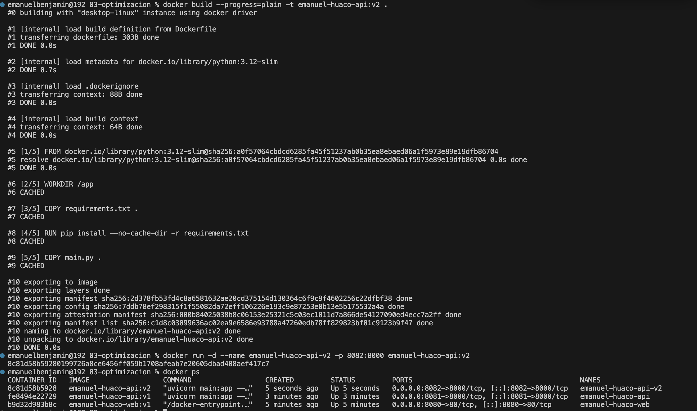
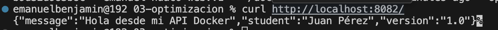

# Laboratorio 03 - Optimización del Dockerfile y Caché

## Datos
**Nombre:** Emanuel Huaco  
**Imagen:** `emanuel-huaco-api:v2`  
**Puerto:** `8082` (8000 interno)

## Objetivo
Optimizar la construcción de imágenes mediante el orden correcto de las capas del Dockerfile (aprovechando el caché de Docker) y el uso de `.dockerignore`.

## Procedimiento

### 1. Construcción optimizada inicial
```bash
docker build --progress=plain -t emanuel-huaco-api:v2 .
```

## Evidencias



### Resultado
Se comprobó que al modificar únicamente el archivo de código fuente, Docker reutilizó las capas previas de dependencias mediante la indicación CACHED, logrando una reconstrucción rápida y eficiente en el puerto 8082.

### Conclusiones
Se comprendió la importancia del orden de las instrucciones dentro del Dockerfile para maximizar la eficiencia del caché de capas y la utilidad del archivo `.dockerignore` para omitir archivos innecesarios en la imagen final.