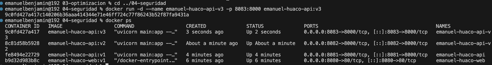
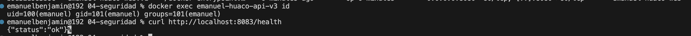

# Laboratorio 04 - Seguridad y Buenas Prácticas

## Datos
**Nombre:** Emanuel Huaco  
**Imagen:** `emanuel-huaco-api:v3`  
**Puerto:** `8083` (8000 interno)

## Objetivo
Aplicar el principio de menor privilegio ejecutando el proceso de la aplicación bajo un usuario del sistema no-privilegiado (non-root) mediante la instrucción `USER`.

## Procedimiento

### 1. Construcción de la imagen segura
```bash
docker build -t emanuel-huaco-api-v3 .
```

## Evidencias



### Resultado
Se verificó mediante el comando docker exec id que el contenedor se ejecuta bajo un usuario del sistema sin privilegios de administrador (UID distinto de 0), manteniendo el correcto funcionamiento del endpoint /health en el puerto 8083.

### Conclusiones
Se aprendió a aplicar buenas prácticas de seguridad en contenedores Docker implementando la instrucción USER para reducir riesgos ante posibles vulnerabilidades en entornos productivos.